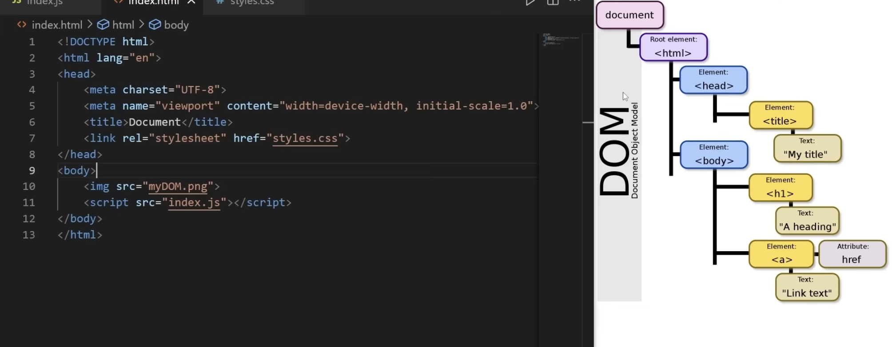

- DOM: Document Object model
    - It is a JS object that represents the page you see in the browser and provides you with an API to interact with it
    - The browser constructs the DOM when it loads an HTML document and structures all of the elements in a tree like structure



```
console.log(document) // display the HTML document

// There are different functions such as:
document.getElementById() ... that get the specific document object

console.dir(document) // list all the properties of this object
document.title etc
document.body.style.backgroundColor = <>
```